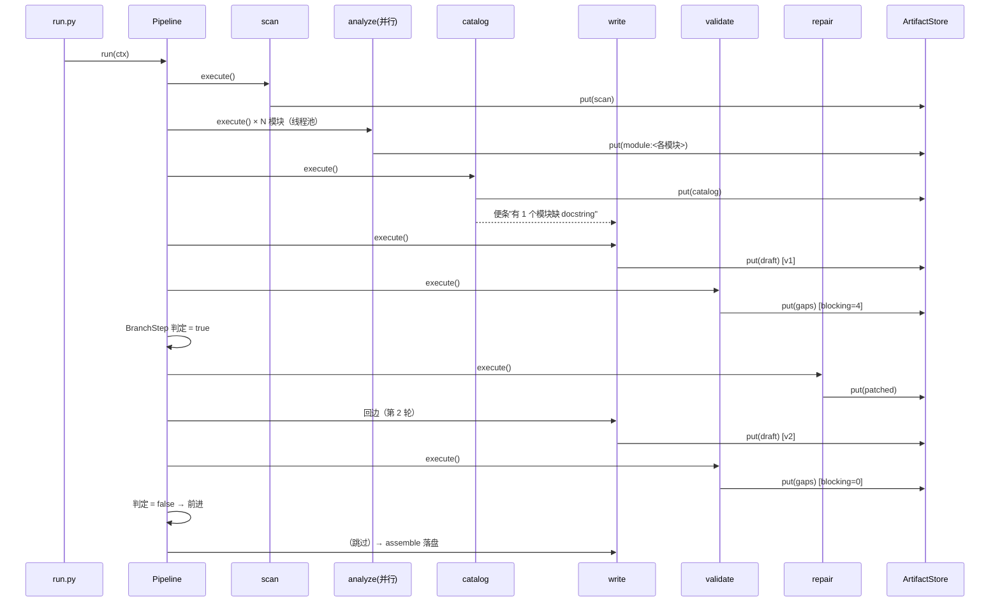

# 设计文档（Design）

> DocForge · 软件项目管理 Homework 2　学号：**2323040304**　姓名：**张子炀**
> 选题：文档生成流程（代码 → 分析 → 文档）

---

## 1. 目标与边界

### 1.1 目标

1. **真的产出文档**：不是把源码原样贴进 Markdown，而是从 AST 提取事实，排成有统计、有索引、有参数表的 API 文档。
2. **多 Agent 协作**：阶段之间通过「带版本的工件」共享状态，通过「便条」做点对点通信。
3. **有完整流程控制**：顺序、条件分支、循环（带轮次守卫）、并行批处理。
4. **可复现**：离线、纯标准库、无随机性；同一份输入两次运行产出一致。
5. **可扩展**：加阶段、加校验规则、换输出格式、换流程，都不需要动内核。

### 1.2 边界（刻意的取舍）

| 不做 | 原因 |
|------|------|
| 接 LLM 生成"业务语义"文档 | 作业允许用 AI，但**产物要可验证**。LLM 文案不可复现，反而没法写测试；本次选择"事实优先" |
| 改源码去补 docstring | 补写只作用于文档文字，不擅自改动别人的代码 |
| 多语言解析 | 只要换 `astlib` 的提取器即可扩展，MVP 不铺开 |
| Web 界面 | 终端流程视图 + `--graph` 已能看清结构；可视化不是本次重点 |

---

## 2. 总体架构

```text
                    ┌──────────────────────────────┐
                    │          run.py（CLI）        │
                    │ 参数 / 装配 / 终端渲染 / 退出码 │
                    └───────────────┬──────────────┘
                                    │
        ┌───────────────────────────┼────────────────────────────┐
        │                           │                            │
┌───────▼────────┐      ┌───────────▼──────────┐      ┌──────────▼─────────┐
│ build_pipeline │      │    RunContext        │      │      Printer       │
│ 流程定义(代码)  │      │ 选项 / 工件 / 便条 / 计数│      │ 事件 → 终端           │
└───────┬────────┘      └───────────┬──────────┘      └──────────┬─────────┘
        │                           │                            │
┌───────▼───────────────────────────▼────────────────────────────▼─────────┐
│                            Pipeline（流水线）                             │
│   StageStep（顺序）   BranchStep（条件 + 回边 + 轮次守卫）   on_fail 策略    │
└───────┬───────────────────────────────────────────────┬──────────────────┘
        │ execute()                                     │ emit()
┌───────▼────────────┐                          ┌───────▼────────────┐
│       Stage        │                          │     EventLog       │
│ Stage / ParallelStage │                        │ 订阅者 + JSONL 落盘 │
└───────┬────────────┘                          └────────────────────┘
        │ puts / gets
┌───────▼──────────────────────────────────────────────────────────────┐
│                          ArtifactStore（工件仓库）                    │
│  name → 最新版本 · name → [v1, v2, …] · out/artifacts/*.json（可恢复） │
└──────────────────────────────────────────────────────────────────────┘

业务层（docforge/stages/）：scan → analyze（并行）→ catalog → write → validate
                              →（repair → 回边 write）→ assemble
工具层：astlib.py（事实提取） · quality.py（缺口/覆盖率） · render.py（Markdown）
```

**分层原则**：`pipeline.py`、`stage.py`、`artifact.py`、`events.py` 里**没有"文档"这个词**。
换一个业务（比如"代码 → 测试"）只要有新的 `Stage` 和新的 `build_pipeline()`，内核原样复用。

---

## 3. 一次运行的时序



---

## 4. 数据模型

| 结构 | 位置 | 作用 | 关键字段 |
|------|------|------|----------|
| `Artifact` | `artifact.py` | 工件：带版本的数据单元 | `name, payload, creator, version, created_at` |
| `ArtifactStore` | `artifact.py` | 仓库：内存 + 磁盘，支持恢复 | `put/get/maybe/with_prefix/dump/load` |
| `Event` / `EventLog` | `events.py` | 过程观测：事件 + 订阅者 + JSONL | `kind, stage, message, elapsed, data` |
| `RunOptions` | `context.py` | 一次运行的参数 | `source, out_dir, max_patch_rounds, threads, start_stage` |
| `RunContext` | `context.py` | 阶段唯一入口 | `store, log, options, rounds, guard_hits, stage_times` |
| `StageResult` | `stage.py` | 阶段产出 | `artifacts{}, message, messages[给谁+一句话]` |
| `Step` / `StageStep` / `BranchStep` | `pipeline.py` | 流程节点 | `name, title, on_fail, retries, goto, max_rounds` |
| `RunSummary` | `pipeline.py` | 运行汇总 | `status, stages_run, rounds, guard_hits, artifacts` |
| `Gap` | `quality.py` | 一条文档缺口 | `module, qualname, kind, severity, detail` |

### 4.1 工件命名约定

| 工件名 | 生产者 | 内容 |
|--------|--------|------|
| `scan` | scan | `{root, files[{path, module, source, lines}], count}` |
| `module:<模块名>` | analyze（每模块一份） | 模块事实（docstring、导入、类、函数、TODO…） |
| `catalog` | catalog | `{modules[], stats, failures}` |
| `draft` | write | `{pages{模块: markdown}, readme, generated_at, meta}` |
| `gaps` | validate | `{items[缺口], blocking, total, coverage}` |
| `patched` | repair | `{"模块:符号": {summary, params, auto}}` |
| `docs` | assemble | `{dir, files[], report, coverage, rounds}` |

版本号是自动递增的：`draft v1`（首轮渲染）、`draft v2`（补写后重渲染），
所以 `out/artifacts/draft.v1.json` 和 `draft.v2.json` 可以 diff 出"补写到底改了什么"。

### 4.2 为什么用"工件"而不是直接传对象

1. **可落盘**：工件是纯 JSON，`--from` 才能复用上次的结果。
2. **可回溯**：每个版本都留档，出问题能定位是哪一轮产生的。
3. **强制解耦**：阶段只能拿工件，不能拿别的阶段的内部对象，顺带杜绝了隐式耦合。

代价是要接受"序列化边界"：阶段内部用 dataclass（`astlib.ModuleInfo`），一出阶段就转成 dict，
后续阶段一律按 dict 读。这条规则在 `astlib._function_to_dict` 与 `quality.iter_symbols` 里贯彻。

---

## 5. 执行模型

### 5.1 主循环（就是在 `Pipeline.run` 里）

```text
index = {阶段名: 位置}
pc = index[start_stage] 或 0
while 0 <= pc < len(steps):
    step = steps[pc]
    emit("stage_start", step.title)
    try:
        outcome = step.run(ctx)          # 阶段自己决定去哪
    finally:
        ctx.stage_times[step.name] += 耗时
    emit("stage_done", step.last_message)
    pc = index[outcome.next_name] if outcome.next_name else pc + 1
```

`StepOutcome.next_name` 为空表示"顺延"，非空表示"跳转"（回边就是跳到更早的位置）。
流程控制没有藏在回调里，就是一个显式的程序计数器，读代码即可知道走向。

### 5.2 `BranchStep`：条件 + 回边 + 守卫

```text
fire = test(ctx)
if fire and rounds_used < max_rounds:
    rounds_used += 1
    执行 stage（例如 repair）
    返回 goto（回边，例如 write）
elif fire:                     # 条件一直成立
    guard_hits += 1            # 守卫触发
    返回 otherwise（例如 assemble）
else:
    返回 otherwise 或顺延
```

三重保护：

| 保护 | 触发条件 | 结果 |
|------|----------|------|
| 业务收敛 | `gaps.blocking == 0` | 不再回边 |
| 轮次上限 | `rounds_used >= max_rounds`（默认 2，`--max-patch-rounds` 可调） | 触发守卫，写入 `guard_hits`，继续收尾 |
| 失败兜底 | 阶段抛异常且 `on_fail="abort"` | 流程 `failed`，返回非 0 退出码 |

实测：`--max-patch-rounds 0` 时，第一次判定就直接触发守卫，覆盖率停在 66.7%，`quality.md` 标注"未通过"——
这证明守卫真的在工作，而不是靠"希望它收敛"。

### 5.3 并行：`ParallelStage`

```text
items   = ctx.require(items_key)["files"]     # 由上游工件决定并行度
workers = min(options.threads, len(items))
with ThreadPoolExecutor(workers):
    futures = {submit(run_one, ctx, item): item}
    for future, item in futures:
        try:    results[id(item)] = future.result()
        except: failures.append(...)
```

两条纪律：

1. **`run_one` 必须是纯函数**：只读 `ctx`，不写仓库、不发便条、不写日志——否则并发写会打架。
   写工件、发便条统一在 `ParallelStage.run` 里、在**主线程**按序完成。
2. **单条失败不拖垮整批**：失败的模块名记进 `module:failures`，由 `catalog` 决定要不要在文档里提示；
   只有"全军覆没"才抛 `StageError`。

### 5.4 错误处理与恢复

| 层级 | 机制 | 位置 |
|------|------|------|
| 单条数据 | 语法错误被 `ast.parse` 捕获，记进 `syntax_error`，页面标注"仅统计未解析结构" | `astlib.parse_source` |
| 单次调用 | `StageStep(retries=N)`：失败重试，事件流记 `retry` | `pipeline.StageStep` |
| 单个阶段 | `on_fail="skip"` 记 `warn` 后继续；`"abort"` 让整条流程失败并返回非 0 | `pipeline.Step` |
| 整条流程 | 未预期异常被 `MissingArtifact` / `PipelineError` 分类型捕获，事件流记 `error`，`run_end` 带 status | `pipeline.Pipeline.run` |
| 断点重跑 | 工件实时落盘；`--from <阶段名>` 从该阶段开始，复用已有工件 | `artifact.dump/load`、`run.py` |

`--from` 的语义是"**阶段幂等**"：每个阶段只依赖上游工件，所以从 `write` 重跑等价于
"用上次的 `catalog`/`patched` 重新渲染"，不重复扫描与解析。实测输出：

```text
已从 out\artifacts 恢复 10 个工件
      ↺ 从阶段 write 开始（复用已有工件）
 [ 1] write      … ✓ 渲染 4 个模块页 + 总览页
 [ 2] validate   … ✓ 覆盖率 100.0%（12/12）
 [ 3] decide_repair … ✓ 条件不成立，直接进入下一阶段
 [ 4] assemble   … ✓ 写出 7 个文件
```

---

## 6. AST 事实提取

### 6.1 提取了什么

| 事实 | 实现要点 |
|------|----------|
| 模块 docstring / 摘要 | `ast.get_docstring` + Google 风格段落解析 |
| 导入（含相对导入） | `Import` / `ImportFrom` → 标准库/第三方/项目内 三分类（`__future__` 不计） |
| 类：基类、装饰器、类属性 | `ClassDef.bases`、`decorator_list`、类体里的 `Assign/AnnAssign` |
| 函数：签名、参数种类、返回注解 | `posonly/args/kwonly/vararg/kwarg` 分别处理，默认值用 `ast.unparse` 还原原文 |
| docstring 结构 | Args / Returns / Raises / Examples 四段（支持续行缩进） |
| 调用关系 | 函数体内 `ast.Call` 的被调方名字，只保留本模块内定义的被调方 |
| 复杂度（粗估） | `1 + 分支/循环/异常/BoolOp/推导式 节点数` |
| TODO/FIXME | 按行正则匹配 `TODO|FIXME|XXX|HACK` |

### 6.2 为什么用 `ast.unparse` 而不是自己拼字符串

`ast.unparse(default)` 能还原 `Decimal("0.01")`、`Decimal | None` 这类写法，比自己拼可靠得多；
代价是它要求 Python 3.9+（本项目最低版本也定在 3.9）。

---

## 7. 文档质量模型

### 7.1 公开符号

模块级公开函数 + 公开类 + 公开方法（`_` 开头的算内部，不计入覆盖率）。
`self` / `cls` 不算参数，方法参数表里会去掉。

### 7.2 缺口分级

| 类型 | 级别 | 例子 | 能否自动补写 |
|------|------|------|--------------|
| `symbol-docstring` | **阻断** | 公开函数完全没有 docstring | 能（结构占位） |
| `params-doc` | 建议 | 有 docstring 但没逐条说明参数 | 不能（需要人判断） |
| `module-docstring` | 建议 | 模块没有 docstring | 不能 |

阻断级才会触发补写回边；建议级只记录，不阻断交付——否则"参数没写全"会让流程永远收敛不了。

### 7.3 补写的边界（重要）

`repair` 只做一件事：给没有说明的符号补一句**结构性占位**，例如

```text
OrderLine.is_valid     → 判断是否「valid」（自动补写，待人工确认）
OrderStore.load        → 加载「load」（自动补写，待人工确认）
```

它**不改源码、不假装理解语义**，并且：

1. 文案里带"待人工确认"；
2. `README.md` 单列「自动补写的条目（需人工确认）」；
3. `quality.md` 有「自动补写记录」；
4. `doc-report.json` 里 `patched` 字段可逐条核对。

这样"覆盖率 100%"不会被误读成"文档质量 100%"——覆盖率只说明**没有空白**，不说明写得对。

---

## 8. 与作业要求的对应

| 作业要求 | 本项目的落点 |
|----------|--------------|
| 至少 2 个 Agent 协作 | 分析（并行）× 撰写 × 校验 × 补写，共 7 个节点 |
| Agent 间消息传递**或**状态共享 | 工件仓库（状态共享，带版本、可落盘）+ 便条信箱（点对点消息） |
| 基本流程控制（顺序） | `Pipeline.add()` 顺序推进 |
| 条件分支 | `BranchStep.test` 读 `gaps.blocking` |
| 循环 | `goto="write"` 回边 + `max_rounds` |
| 并行 | `ParallelStage` + 线程池（每模块一个任务） |
| 可视化 | 终端流程视图、回边与并行标注、`--graph` |
| 日志与状态追踪 | `EventLog`（JSONL）+ 工件版本目录 + `doc-report.json` |
| 错误处理与恢复 | `retries` / `on_fail` / `--from` 重跑 / 语法错误不致命 |
| 文档 | README（使用说明）+ 本文（设计说明，含架构图与时序图） |

---

## 9. 关键决策与取舍

| 决策 | 备选 | 为什么这样选 |
|------|------|--------------|
| 流程用**代码**定义（`build_pipeline`） | JSON/YAML 配置 | 只有 7 个节点、两条回边判断，写成代码更短、能类型检查、能被单测覆盖；JSON 适合节点多、非程序员维护的场景 |
| 阶段间用**工件仓库** | 直接函数调用 / 全局变量 | 可落盘、可回溯、`--from` 重跑、便于并发安全 |
| 同时保留**便条** | 只用工件 | 有些判断不属于数据（如"这个模块缺 docstring，渲染时标注一下"），用消息更自然 |
| 并行放**阶段内部** | 流水线级 fan-out/join | 解析是"同一逻辑 × N 条目"，`ParallelStage` 只需实现 `run_one`，比在流程里画 fork/join 更省事 |
| 回边用**显式 goto + 计数** | while 循环包住整段 | goto 式程序计数器让"流程"集中在一处，`ascii()` 能直接画出回边 |
| 补写只写文档不写源码 | 直接给源码补 docstring | 擅自改别人的代码风险高；文档占位 + 标注确认更保守 |
| 离线、不用 LLM | 用 LLM 生成描述 | 产物要可验证、可复现、可测试；LLM 更适合做"润色"，不适合做"事实" |
| 复杂度用节点计数 | radon 等库 | 零依赖；粗估足够做"拆分建议"，不追求学术精确 |
| 渲染与判定分离 | 一处搞定 | `quality.py` 可以单测（纯数据），`render.py` 可以单测（纯字符串），互不干扰 |

---

## 10. 扩展点

1. **加阶段**：`class XxxStage(Stage)` 实现 `run()` → `build_pipeline()` 里 `add()`。台账见 README 第 6 节。
2. **加校验规则**：`quality.find_gaps()` 里追加一条判断，阻断/建议由 `severity` 决定是否进循环。
3. **加输出格式**：`render.py` 加函数 + `assemble` 里调用。
4. **换解析语言**：替换 `astlib.parse_source`，保证输出同构的 dict 即可（`quality`/`render` 不用动）。
5. **接人工评审**：写一个 `ManualReviewStage`，读取 `gaps` 里的建议级缺口，把评审意见写成工件的附加字段；
   因为它不可复现，必须挂在"建议级"而不是"阻断级"，否则流程无法收敛。

---

## 11. 局限与后续

1. **不做跨模块分析**：调用关系只在模块内；跨模块依赖只到"导入了谁"这一层。
2. **文档深度有限**：能说清"有什么、参数是什么、抛什么异常"，说不清"业务上为什么这么设计"——后者仍要靠人写 docstring。
3. **复杂度是粗估**：`1 + 分支数`，对嵌套/早返回的权重不敏感。
4. **并行无超时**：解析大仓库时若某个文件卡住（极少见），只能整体等待；可加 `future.result(timeout=…)`。
5. **工件无版本兼容**：`--from` 只保证同一次代码版本内重跑。
6. **未实现增量**：目前每次全量解析，可结合 mtime/哈希做缓存。

**后续可做**：增量解析缓存、跨模块调用图、HTML/JSON Schema 输出、把"建议级缺口"接给 LLM 润色（人工确认后再改动）。
