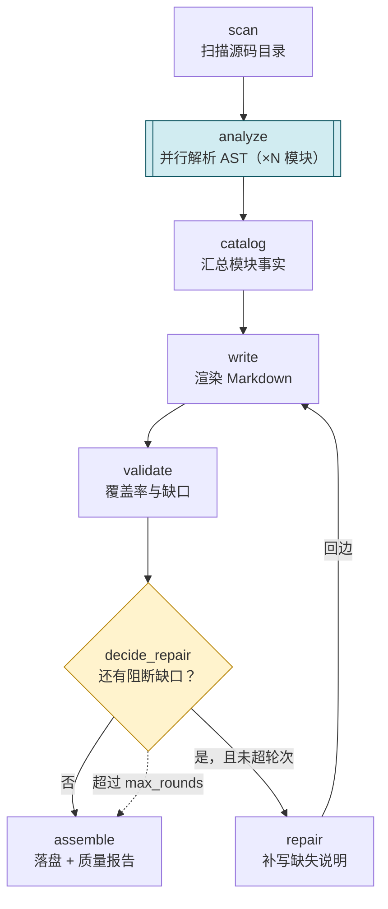

# DocForge — 代码 → 分析 → 文档 的多 Agent 工作流

> 软件项目管理 · Homework 2　学号：**2323040304**　姓名：**张子炀**
> 选题方向：**文档生成流程（代码 → 分析 → 文档）**

---

## 1. 一句话说明

给一个 Python 代码目录，DocForge 自动产出**可交付的 API 文档**：
扫描 → 并行解析 AST → 汇总事实 → 渲染 Markdown → **校验文档覆盖率** →
有缺口就**补写并重新渲染**（受轮次上限保护）→ 落盘文档与质量报告。

三个阶段（Agent）承担全部业务：**扫描/分析 Agent**、**文档撰写 Agent**、**文档校验 Agent**（含补写能力）。
零第三方依赖，不需要 API Key，`python run.py` 一条命令跑通。

---

## 2. 快速开始

### 2.1 环境

* Python **3.9+**（开发环境 3.13）
* 无第三方依赖（`ast` / `json` / `dataclasses` / `concurrent.futures` 等标准库）

### 2.2 运行

| 命令 | 作用 |
|------|------|
| `python run.py` | 生成 `examples/sample_pkg` 的文档（默认演示） |
| `python run.py --src 你的代码目录` | 换成自己的目录 |
| `python run.py --graph` | 只看流程，不执行 |
| `python run.py --max-patch-rounds 0` | 关掉补写回边，观察**循环守卫** |
| `python run.py --from write` | **复用已落盘工件**，从渲染阶段重跑 |
| `python run.py --threads 8` | 调整并行解析的线程数 |
| `python run.py --json` | 结束时输出机器可读摘要 |
| `python run.py -v` | 显示细节事件（每个模块解析结果等） |
| `python tests/run_tests.py` | 跑 54 个单元测试 |

Windows 下也可以双击 `start.bat`（生成文档）/ `test.bat`（跑测试）。

### 2.3 实际运行输出

```text
==========================================================================
 DocForge · 代码 → 分析 → 文档（多 Agent 文档生成工作流）
 作者      : 2323040304 张子炀
 扫描目录  : examples/sample_pkg
 输出目录  : out
 补写轮次  : 最多 2 轮 · 解析线程 4
==========================================================================

--------------------------------------------------------------------------
 流程
--------------------------------------------------------------------------
  1. [>>] scan           扫描源码目录
  2. [>>] analyze        解析模块结构  (批处理·并行)
  3. [>>] catalog        汇总模块事实
  4. [>>] write          生成 Markdown 章节
  5. [>>] validate       校验文档覆盖率
  6. [??] decide_repair  覆盖率不足 → 补写并重新渲染
  7. [>>] assemble       落盘文档与报告

  回边 / 循环：
    decide_repair --回边--> write（最多 2 轮）
--------------------------------------------------------------------------

▶ 流水线 docgen 启动：7 个阶段，起点 scan
 [ 1] scan          扫描源码目录 … ✓ 扫描到 4 个模块，共 179 行  (2 ms)
 [ 2] analyze       解析模块结构 … ✓ 并行处理 4/4 个条目（4 线程）  (5 ms)
 [ 3] catalog       汇总模块事实 … ✓ 汇总 4 个模块：3 个类、3 个函数、12 个公开符号  (1 ms)
 [ 4] write         生成 Markdown 章节 … ✓ 渲染 4 个模块页 + 总览页（第 1 轮）  (1 ms)
 [ 5] validate      校验文档覆盖率 … ✓ 覆盖率 66.7%（8/12），阻断缺口 4 个、建议 0 个  (1 ms)
      ↩ 条件成立 → 自动补写缺失说明（第 1/2 轮），回边到 write：补写 4 个符号：OrderLine.is_valid、Order.total_quantity、summarize、OrderStore.load
 [ 6] decide_repair 覆盖率不足 → 补写并重新渲染 … ✓ 条件成立 → 自动补写缺失说明（第 1/2 轮），回边到 write  (1 ms)
 [ 7] write         生成 Markdown 章节 … ✓ 渲染 4 个模块页 + 总览页（第 2 轮）  (1 ms)
 [ 8] validate      校验文档覆盖率 … ✓ 覆盖率 100.0%（12/12），阻断缺口 0 个、建议 2 个  (1 ms)
      → 条件不成立，直接进入下一阶段
 [ 9] decide_repair 覆盖率不足 → 补写并重新渲染 … ✓ 条件不成立，直接进入下一阶段  (0 ms)
 [10] assemble      落盘文档与报告 … ✓ 写出 7 个文件到 out\docs（覆盖率 100.0%，补写 1 轮）  (2 ms)

■ 流水线结束：completed，执行 10 次阶段，补写 1 轮

==========================================================================
 生成成功：完成（0.01s）
 执行阶段 : 10 次（含回边）
 补写循环 : 1 轮
 文档覆盖 : 100.0%（12/12，自动补写 4 项）
 文档目录 : out\docs
 JSON 报告: out\doc-report.json
 事件日志 : out\events.jsonl
==========================================================================
```

### 2.4 产物

| 路径 | 内容 |
|------|------|
| `out/docs/README.md` | 总览：统计、覆盖率、模块索引、自动补写清单、待办汇总 |
| `out/docs/<模块>.md` | 每个模块一页：结构速览、依赖、类/函数签名表、参数表、异常、示例、调用关系图 |
| `out/docs/quality.md` | 文档质量报告：覆盖率、缺口清单（阻断/建议）、补写记录 |
| `out/doc-report.json` | 机器可读报告（统计 + 缺口 + 补写 + 工件版本） |
| `out/events.jsonl` | 结构化事件流（一行一个事件） |
| `out/artifacts/*.json` | 每个工件的每个版本，`--from` 重跑就是靠它 |

---

## 3. 作业要求对照

### 3.1 必须实现

| 要求 | 完成情况 | 位置 |
|------|----------|------|
| 至少 2 个 Agent 协作完成一个完整流程 | **7 个节点（6 个阶段 + 1 个条件判定）**：扫描、解析（并行）、汇总、撰写、校验、补写、落盘 | `docforge/stages/` |
| 实现 Agent 间的消息传递**或**状态共享 | **两者都有**：工件仓库（带版本的状态共享）+ 便条信箱（点对点消息） | `docforge/artifact.py`、`context.py` |
| 支持基本的流程控制（顺序执行） | 阶段顺序推进，回边由 `Pipeline.branch` 显式声明 | `docforge/pipeline.py` |
| MVP 可运行即可，不需要复杂调度 | 零依赖、离线、`python run.py` | `run.py` |

### 3.2 推荐实现

| 要求 | 完成情况 |
|------|----------|
| 条件分支 | `BranchStep`：覆盖率是否达标决定走"补写"还是"收尾" |
| 循环 | 回边 `decide_repair → write`，最多 N 轮（默认 2），由 `max_rounds` 守卫 |
| 并行执行 | `ParallelStage`：每个模块一个任务，线程池并发解析，`--threads` 可调 |
| 可视化 Workflow 编排界面 | 终端流程视图（阶段/回边/并行标注）+ `--graph` |
| 执行日志与状态追踪 | `EventLog`：JSONL 事件流 + 工件版本目录 + `doc-report.json` |
| 错误处理与恢复 | 阶段级 `retries` 与 `on_fail`（`abort` / `skip`）；工件落盘后 `--from` 从任意阶段重跑 |
| 文档 | 本文件 + `DESIGN.md`（含架构图、时序图、执行模型、取舍说明） |

---

## 4. 目录结构

```text
DocForge/
├── run.py                  # 入口：参数解析、装配、终端渲染
├── start.bat / test.bat    # Windows 一键运行 / 一键测试
│
├── docforge/               # ===== 工作流内核（与"文档生成"业务无关）=====
│   ├── artifact.py         #   工件 + 带版本仓库（含落盘/恢复）
│   ├── events.py           #   事件流（订阅者模式）
│   ├── context.py          #   运行上下文：工件、便条、计数、计时
│   ├── stage.py            #   Stage / ParallelStage：阶段模板方法
│   ├── pipeline.py         #   流水线：顺序、条件回边、轮次守卫、失败策略
│   ├── astlib.py           #   AST 事实提取（签名/docstring/依赖/复杂度/待办）
│   ├── quality.py          #   公开符号、缺口、覆盖率、统计
│   └── render.py           #   Markdown 渲染（模块页 / 总览页 / 质量页）
│
├── docforge/stages/        # ===== 业务阶段（作业里的 Agent）=====
│   ├── scan.py             #   scan：找 .py 文件
│   ├── analyze.py          #   analyze：并行解析每个模块（ParallelStage）
│   ├── catalog.py          #   catalog：汇总模块事实 + 统计
│   ├── write.py            #   write：渲染 Markdown（文档撰写 Agent）
│   ├── validate.py         #   validate：覆盖率与缺口（文档校验 Agent）
│   ├── repair.py           #   repair：补写缺失说明
│   ├── assemble.py         #   assemble：落盘 + 质量报告 + JSON 报告
│   └── __init__.py         #   build_pipeline()：流程全貌
│
├── examples/sample_pkg/    # 待生成文档的示例包（4 个模块，docstring 质量刻意不均匀）
├── tests/                  # 54 个单元测试
└── out/                    # 运行产物（自动生成）
```

---

## 5. 流程与阶段职责



| 阶段 | 角色 | 读什么工件 | 写什么工件 | 给下游的便条 |
|------|------|-----------|-----------|--------------|
| `scan` | 采集 Agent | 目录 | `scan`（文件清单+源码） | → analyze：本次要解析哪些模块 |
| `analyze` | 分析 Agent（并行） | `scan` | `module:<名字>`（每个模块一份事实） | — |
| `catalog` | 汇总 Agent | `module:*` | `catalog`（模块列表 + 统计） | → write：哪些模块没 docstring |
| `write` | **文档撰写 Agent** | `catalog`、`patched` | `draft`（各页 Markdown） | → validate：本次用了多少补写 |
| `validate` | **文档校验 Agent** | `catalog`、`patched` | `gaps`（缺口 + 覆盖率） | → repair：哪些符号要补 |
| `repair` | 补写 Agent | `gaps` | `patched`（补写内容） | → write：补了几条 |
| `assemble` | 交付 Agent | `draft`、`gaps`、`catalog` | `docs`（文件清单+报告） | — |

**双通道协作**（对应作业"Agent 间通信或状态共享"）：

| 通道 | 是什么 | 例子 |
|------|--------|------|
| 工件（状态共享） | 带版本号的数据单元，落盘成 JSON，可回溯、可重放 | `catalog`、`draft`、`gaps`、`patched` |
| 便条（消息传递） | 阶段之间点对点的一句话判断，不影响数据正确性 | `catalog → write`："有 1 个模块没有 docstring" |

一个阶段只返回 `StageResult`，由框架统一写工件、投便条——所以阶段之间**没有直接调用**，
任何一个阶段都能单独重跑（`--from`）或单独测试。

---

## 6. 怎么扩展

| 想加什么 | 改哪里 | 引擎要动吗 |
|----------|--------|-----------|
| 新的处理步骤（如"生成 HTML 版"） | 写一个 `Stage` + 在 `build_pipeline()` 里 `add()` | 不用 |
| 新的文档校验规则（如"必须写 Examples"） | `quality.find_gaps()` 里加一条判断 | 不用 |
| 新的输出格式（HTML/JSON Schema） | `render.py` 加一个渲染函数，`assemble` 里调用 | 不用 |
| 换另一条流程（如"代码 → 测试"） | 另写一个 `build_xxx_pipeline()`，复用内核 | 不用 |

示例：加一个"生成 HTML 版"的阶段，只需三个动作。

```python
# 1) docforge/stages/html.py
from ..stage import Stage, StageResult

class HtmlStage(Stage):
    name = "html"
    title = "生成 HTML 版"

    def run(self, ctx):
        pages = ctx.require("draft")["pages"]
        html = {name: f"<h1>{name}</h1><pre>{text}</pre>" for name, text in pages.items()}
        return StageResult(artifacts={"html": html}, message=f"生成 {len(html)} 个 HTML 页")

# 2) build_pipeline() 里加一行
pipeline.add(HtmlStage())

# 3) 完事，其它阶段不用改
```

---

## 7. 测试

```bash
python tests/run_tests.py
# Ran 54 tests ... OK
```

| 测试文件 | 覆盖内容 |
|----------|----------|
| `test_astlib.py` | 签名/参数种类、Google 风格 docstring 各段落、依赖三分类、复杂度、TODO、语法错误容错、`__future__` 不误判 |
| `test_artifacts.py` | 工件版本递增、缺失工件报错、前缀查询、落盘后恢复最新版本、事件订阅与 JSONL |
| `test_pipeline.py` | 顺序执行、回边只跑一次、守卫拦截死循环、0 轮守卫、重试、失败 abort/skip、缺工件快速失败、流程校验（重名/回边方向/起点） |
| `test_quality_render.py` | 公开符号只算非下划线、缺口分级、补写后覆盖率 100%、表格转义竖线、方法参数不带 self、自动补写标记只出现一次 |
| `test_end_to_end.py` | 端到端产物、事件种类、守卫模式留缺口、`--from` 重放、CLI 的 `--graph/--json` 与失败退出码 |

---

## 8. 启动不了怎么办

| 现象 | 解决 |
|------|------|
| 双击 `start.bat` 一闪就没 | 改用命令行 `python run.py`，能看到完整报错 |
| 批处理没反应/卡住 | 确认 `start.bat` 是 **CRLF** 换行（从 Git 或某些编辑器复制可能被改成 LF，Windows 批处理对 LF 容错很差）；本项目自带的已是 CRLF |
| 提示找不到 `python` | 装 Python 3.9+（勾选 Add to PATH），或用 `py -3 run.py` |
| 中文乱码 | 用 Windows Terminal；`start.bat` 已执行 `chcp 65001` 并设置 `PYTHONUTF8=1` |
| 只想跑一次看结果 | `python run.py --quiet`（只输出摘要） |

> `start.bat` 末尾的 `pause` 是为了让你看清结果；设环境变量 `WORKFLOW_NO_PAUSE=1` 可跳过。

---

## 9. 已知限制

1. **只解析 Python**：`ast` 是标准库，换语言要换提取器（内核不用动，见第 6 节）。
2. **静态事实，不做语义理解**：文档描述来自 docstring 与命名推断；自动补写的句子**只是结构性占位**，
   报告里全部标注"待人工确认"，不冒充作者原意。
3. **单文件视角**：不跟踪跨模块调用链、不做类型推断，因此"调用关系"图只在模块内。
4. **复杂度是粗估**：分支/循环节点计数，不是严格的圈复杂度。
5. **并行是线程级**：解析是 CPU 轻量任务，线程池够用；不是分布式调度。
6. **`--from` 依赖已落盘工件**：只保证"从某个阶段往后重跑"，不保证跨版本兼容（工件结构变了要清 `out/artifacts`）。
